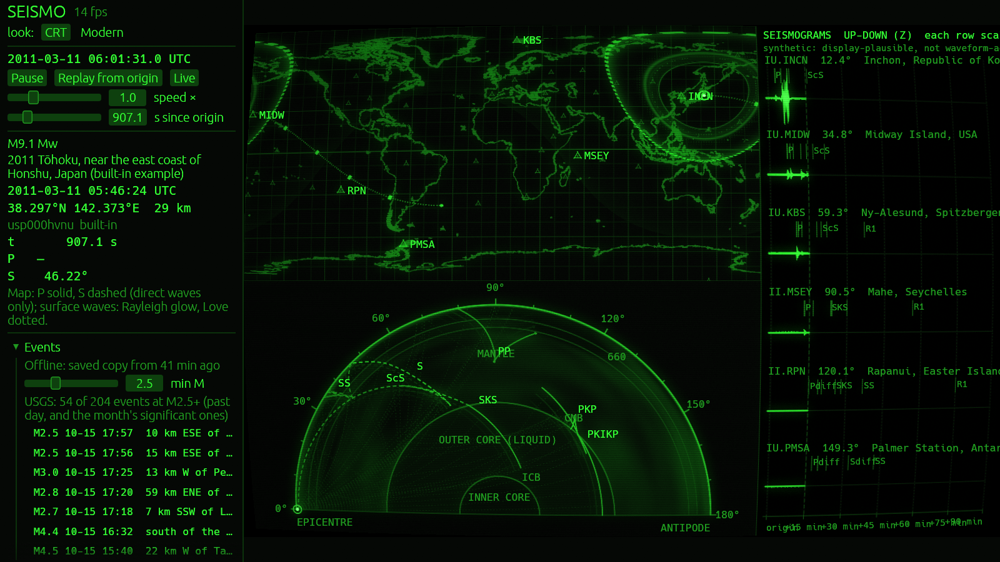
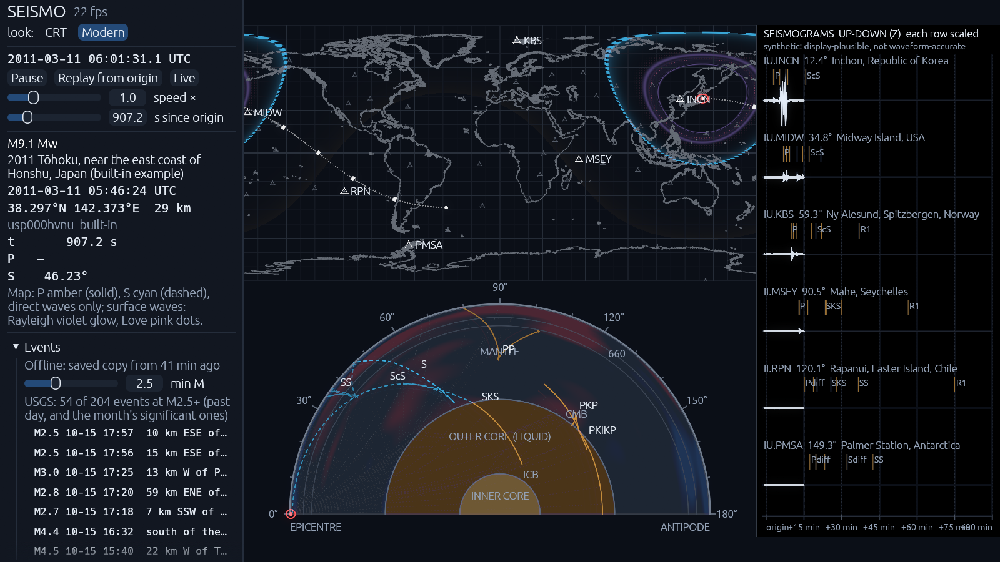

# SEISMO

A global earthquake simulator in Rust. Enter a quake, pick a past one, or follow the live USGS
feed, and watch its seismic waves cross the planet. A world map shows the fronts of each wave
type. A cut through the Earth shows the rays bending through the mantle and core. Virtual
seismographs at real stations show the traces they would record.

The waves come from the ak135 Earth model, optionally perturbed by the SP12RTS 3D mantle
model, with dispersive surface waves. Every shortcut is listed in
[docs/approximations.md](docs/approximations.md). The seismograms are display-plausible, not
waveform-accurate, and the app says so.



Two looks are available: a green-phosphor CRT (the default) and a modern dark one.



## What it does

- **Map.** Shows P and S fronts per pixel from travel-time tables, nudged by 3D-mantle delays.
  Rayleigh and Love surface-wave bands are drawn for M5+ events. Up to 32 events show at once.
- **Slice.** A cross-section along a great circle from the epicentre, at any azimuth. It shows
  ray fans and wavefronts for each phase, bent through the 3D mantle when that is on. The
  mantle can be shaded fast or slow.
- **Seismograms.** Synthetic vertical or transverse traces at bundled Global Seismographic
  Network stations, or at any point clicked on the map. Arrivals are marked by phase. Where
  the earthquake's fault is known (from USGS, or set by you), P and S waves follow its
  radiation pattern: stronger in some directions, starting with a push or a pull, shown as a
  beach ball in the event panel.
- **Events.**
  - The live USGS feeds are polled every minute and work offline from a saved copy.
  - Past events can be searched by date and magnitude or by USGS id.
  - You can make your own event of any kind: earthquake, nuclear test, volcanic tremor,
    landslide or impact. An earthquake can be given a fault orientation.
- **Clock.** The clock is absolute UTC and can be paused, scrubbed, replayed from origin, or
  run at 0.1 to 1000 times real speed.
- **Guide.** A built-in guide explains how to use the program and what each picture shows. It
  also has short lessons on earthquakes, P, S and surface waves, the Earth's interior, the core's
  shadow zone, magnitude, locating quakes and seismic tomography. Its numbers are read from the
  Earth model the app simulates. Open it with the Guide button or F1. Every section of the
  controls has a **?** that explains it in place. In the terminal version, press `g`.

## Terminal version

`seismo-tui` runs the same simulation, feed, event list and traces in a terminal. It draws on
a braille canvas, has no 3D mantle and no event form, and supports both looks in colour.

```
 SEISMO 2011-03-11 06:01:27 UTC  ▶ 1×  M9.1 2011 Tōhoku, near the east coast of Honshu, Japan (built
⣤⣤⣀⣀           ⣀⣀⣤⣤⣤⣤⣤⣄⣤⣤⣤⠤⢤⣤⣤⣄⣀    ⣀⣀⣀⣀⣀ ⣀⣀⣀⣀⡀ ⣀⣀⣀⣠⣤⣤⡤⠤⠤⠤⠤⠤⠤⠤⠤⠤⠤⠤⠤⢤│ EVENTS  56 listed, M2.5+ m/M
⣄ ⢉⣀⣀⣠⣀⣀⣀⣀⣶⣿⣿⣿⣿⣿⣿⣿⣿⣯⣝⡛⠒⢦⣄   ⣠⣼⠟ ⡀  ⠈▲KBS⣀  ⣠⣶⣖⣺⣦⣼⢶⠾⠛⠛⠫⠷⠶⠤⠤⣤⣴⡶⠶⣖⣈⣀⣀⣀⣀│ M3.1 2026-10-14 57 km NW of Sa
⠛⡻⣿⣿⣘⣿⣆⣀⣉   ⠉⠉⠉⠉⡿⠻⢿⡿⢿⣿⡃⠘⢿⣤⠞⠋⠉⠛⠿⠃⢠⣀⢠⣴⡟⣵⣖⣀⠛⠛⠋⠉⠉⠁⠈⠹⣩     ⠂⠂⠂⠂  ⢀⣀⣀⡤⣧⣇⡷⠶│ M3.0 2026-10-14 12 km NE of Wa
⠤⠬⠖⠛⢹⡏  ⠙⢷⣤   ⠐ ⠉⠙⠺⠏⢈⣡⣿⣦⡀       ⢾⣿⡶⠛⡛⠛⠋ ⠐    ⠁  ⠟⡀  ⠂⠂⡂    ⠘⣻⡆ ⡿⠚⠒⠰⠦│ M6.8 2026-10-13 central Mid-At
⠂   ⡠     ⢾⡀    ⢀  ⣸⠽⠛⠛⠉⠁   ⣀⡀  ⣖⣛⣴⣲⣿⣶⣤⡿⠿⠷⠘⣿⡅ ⠠  ⡇  ⠂   ⣠▲IN*N⠉⣀⡀   │ M6.7 2026-10-13 central Mid-At
▲MIDW     ⠈⢳⣦⡈ ⢀⣤⡤⣴⡋ ⠐       ⠁⢐⣄⡟⠉⠉⠙⠻⠴⠻⠭⣽  ⣬⣁    ⠘⢡  ⠂⠂ ⢸⠟⣿⠛⠉   ⠁⠈⠑⠂│ M6.1 2026-10-12 17 km W of Río
 ⢠⠞⠐⠦⢀      ⠈⠟⣆⣸⣤⣶⠻⣿⣦⣄⡀      ⣀⢰⠃        ⠘⣧⡐⢉⣩⠏⠙⢶ ⣀⠞⢦⡠⠠⣶⠒⢻⡍⠁      ⠄⠂ │ M6.0 2026-10-10 7 km N of La T
⠴⠂    ⠁⠠⡀      ⠈⠉⠻⢧⡴⠶⠶⢿⣀     ⠉⠘⢧⡀⡀⣀⡀     ⠍⠟⡿⠂  ⠈⠧⡇ ⢾⣹⡷⡞⢀⣼⣿ ⡂⠆⠋⠂⢂⠂⢀⡀ │ M6.6 2026-10-09 12 km W of Río
   ⠈⠂    ⠓⢀⡀    ⠰⠄⢰⠃    ⢷⢤⣀⡀    ⠉⠉ ⠻⡀  ⠠ ⣠⠖⠁▲MSEY  ⠈⢻⣿⣽⣫⣿⣾⣦⣤⣤⣠⣄⡀ ⠤⠶ │ M5.8 2026-10-09 1 km S of El C
 ⣀     ⠐   ⠁⠢     ⠈⢆  ⠂   ⢠⠇   ⠁    ⡷  ⡀ ⢻⢴⣄   ⠈    ⠄⠉⠙⠛⠚⣟⣻⢽⢻⡟⠿⠝⠷⣤  │ M7.7 2026-10-09 12 km WSW of P
⠱⠒ ⠠ ⠉⠉⠁⠃⡀   ⠈⠉⠠⡄   ⢹   ⢀⡤⠞         ⢳   ⣸⠉⣿⠇⠶⠐         ⣴⠒⠋ ⠈⠉⠙⢦ ⠐⠾⠂⠙│ M6.3 2026-10-08 102 km NE of N
⠂            ▲RPN⠈⠁⠤⡿⢀⣠⣤⠞           ⠈⢧⡤⠔⠁              ⢹⣠⠤⠶⢤⡄ ⣸⠁  ⢀⡀│ M5.5 2026-10-06 92 km NNW of A
⠠                  ⢰⡇⣴⠋⠁⠉⠁⠈    ⠈         ⡀ ⢀                ⠉⠿⠃  ⣠⡾⠋│ M4.7 2026-10-02 5 km NNE of Ko
                   ⠸⠿⡯⠒⠂  ⠠⠄⢀⡀                ⠈⠡                ⠄⠒  │ M4.2 2026-09-29 6 km WNW of Wa
                    ⢀▲PMSA  ⠈⠁          ⡀⢀⣀⣠⢤⣀⣀⡀⢀⣀⣀⣤⣤⡤⣠⣄⣀⣀⣠⣤⣀⣀⣀⡀⢀⡀  │ M6.6 2026-09-25 80 km ENE of T
  ⢀⣀⣀⣠⣤⠤⠤⠴⠶⠶⠶⠤⠶⠖⠒⠒⣒⣾⣿⡯⠿ ⣀⣀ ⣀⡤⠴⠶⠞⠛⠛⠉⠉⠉⠉⠉⠉⠉⠉    ⠘⠛⠉             ⠈⠉⣭⣟⠃ │ M6.4 2026-09-20 50 km NNE of K
⠒⠒⠶⠿⠿⠋⠁           ⠈⠉⠉⠙⠛⠚⠋⠛⠉⠉⠉⠉                               ⡀ ⠈⠛⠒⠒⠒│ M6.5 2026-09-17 177 km W of Ni
SEISMOGRAMS  up-down (Z)  each row scaled  ·  synthetic: display-pla│=M8.3 2013-05-24 2013 Sea of Ok
INCN      12° ⠤⠤⠤⠤⡶⡦⠤⠤⠤⠤                                            │●M9.1   15m ago 2011 Tōhoku, ne
MIDW      35° ⠤⠤⠤⠤⠤⠤⠤⠤⠤⠤   R1                                       │ SELECTED
KBS       59° ⠤⠤⠤⠤⠤⠤⠤⠤⠤⠤ S SS       R1                              │ 2011 Tōhoku, near the east
MSEY      90° ⠤⠤⠤⠤⠤⠤⠤⠤⠤⠤PP  SKS SS              R1                  │coast of Honshu, Japan
RPN      120° ⠤⠤⠤⠤⠤⠤⠤⠤⠤⠤ PKPdf      SS                     R1       │(built-in example)
PMSA     149° ⠤⠤⠤⠤⠤⠤⠤⠤⠤⠤Pdiff          SS                           │ 2011-03-11 05:46:24 UTC
                                                                    │ 38.30°, 142.37°  depth 29 km
                                                                    │ Mw 9.1  earthquake  built-in
                                                                    │ 6 stations shown (click the
         min  0     10 ▲  20    30    40    50    60    70    80    │map to change)
 ? keys  g guide  space pause  ←→ ±30s  shift ←→ ±5min  +- speed  r replay  n now  ↑↓ enter pick eve
```

## Building and running

You need Rust; `rust-toolchain.toml` pins the version, and rustup installs it on first use. All
assets are embedded in the binaries, so they run from any folder and work offline.

On Windows, double-click `SEISMO.cmd` in the repo root. It builds the desktop app if the code
has changed (a few minutes the first time), then opens it; arguments are passed to the app.

To give SEISMO to someone else, send `target\release\seismo.exe` on its own. It needs no
installer, no other files and no Visual C++ runtime (`.cargo/config.toml` links the C runtime
statically), only Windows 10 or later with a DirectX 12 or Vulkan graphics driver.

```
cargo run -p app --release        # the desktop app (wgpu; developed on Windows)
cargo run -p tui --release        # the terminal version; press ? for keys
cargo test --workspace            # the test suite (no GPU or network needed)
cargo clippy --workspace -- -D warnings
```

The `Makefile` wraps the same commands. CI runs formatting, clippy and the tests on Linux and
Windows for every push to `main` and every pull request.

### Command-line flags (desktop app)

| Flag | Effect |
|---|---|
| `--look crt\|modern` | The look to start with (default `crt`) |
| `--event <id>` | Select an event: the built-in one (`usp000hvnu`), one of yours (`made-<n>`), or a USGS id, which is looked up, kept and replayed |
| `--start-offset <s>` | Replay the selected event from that many seconds after its origin |
| `--speed <x>` | Initial clock speed |
| `--paused` | Start with the clock stopped |
| `--offline` | No network; events come from the saved copy |
| `--make` | Open the make-your-own-event form |
| `--mantle <x>` | 3D-mantle strength: 0 is 1D, 1 is the published model, above 1 is exaggerated |
| `--surface <x>` | Surface-wave band brightness; 0 hides them |
| `--coast off,wide` | Coastline options |
| `--azimuth <deg>` | Direction of the slice from the epicentre |
| `--phases all` or `--phases P,S,PKiKP` | The phases drawn in the slice (default: all but PcS, ScP, PKiKP, PKKP, SKKS, PS, SP) |
| `--traces off,side,shared,<n>min` | Hide the traces, show the transverse component, use one amplitude scale, or show `<n>` minutes of record (5–120) |
| `--crt <list>` | Turn CRT effects off: `off`, `noscan`, `nopersist`, `nobloom`, `nobarrel`, `noflicker`, `nohot`, `novignette`, `nonoise`, `nohum`, `nowarmup` |
| `--size <W>x<H>` | Window inner size in physical pixels |
| `--capture <file.ppm>` | Save the rendered scene after `--capture-after <s>` seconds (default 3), then quit |
| `--capture-ui <file.ppm>` | The same for the whole window, controls included |
| `--map-cap <n>` | Draw at most n events on the map (1 to 32) |
| `--bench <s>` | Measure frame times without vsync after a warm-up, report them, then quit. `--bench-warmup <s>` and `--bench-out <file>` adjust it. |

The terminal version's flags are listed by `seismo-tui --help`.

## Layout

| Crate | Role |
|---|---|
| `crates/tables` | Travel-time tables, the ak135 velocity model, dispersion curves and SP12RTS: formats and interpolation |
| `crates/sim` | The simulation and ray tracer: pure, deterministic, no GPU, no I/O, no threads |
| `crates/feed` | USGS fetch, cache and parsing (tokio and reqwest, on its own thread) |
| `crates/render` | The wgpu passes: map, slice, traces, CRT post-process |
| `crates/session` | What a front end needs besides drawing: clock, event list, made events, traces, the guide's text, embedded assets |
| `crates/app` | The desktop app (eframe and egui) |
| `crates/tui` | The terminal app (ratatui) |

`CLAUDE.md` holds the design rules and conventions. `docs/approximations.md` lists every
physics shortcut. `docs/plans/roadmap.md` lists candidate next steps.

## Data and sources

The generated assets in `assets/` are committed. The scripts in `tools/` regenerate them, and
each file's header records its source.

- **ak135 travel times and velocity model.** Kennett, B. L. N., E. R. Engdahl & R. Buland
  (1995). Constraints on seismic velocities in the Earth from traveltimes. *Geophys. J. Int.*,
  122, 108–124. The tables are computed with ObsPy's TauP (Krischer, L., et al. (2015), ObsPy: a
  bridge for seismology into the scientific Python ecosystem, *Comput. Sci. Discov.*, 8, 014003)
  by `tools/gen_tables.py`.
- **SP12RTS 3D mantle.** Koelemeijer, P., J. Ritsema, A. Deuss & H.-J. van Heijst (2016).
  SP12RTS: a degree-12 model of shear- and compressional-wave velocity for Earth's mantle.
  *Geophys. J. Int.*, 204(2), 1024–1039. doi:10.1093/gji/ggv481. The files are bundled
  unchanged; see [assets/sp12rts/README.md](assets/sp12rts/README.md).
- **Surface-wave dispersion.** Rayleigh and Love phase and group velocities of ak135, computed
  with disba (Luu, K. (2021), disba: numba-accelerated computation of surface wave dispersion)
  by `tools/gen_dispersion.py`. Attenuation follows PREM's Q (Dziewonski, A. M. & D. L. Anderson
  (1981), Preliminary reference Earth model, *Phys. Earth Planet. Inter.*, 25, 297–356).
- **Stations.** Global Seismographic Network, FDSN networks IU and II, from the EarthScope FDSN
  station service, by `tools/gen_stations.py`.
- **Coastlines.** Natural Earth 1:10m coastline (public domain), simplified by
  `tools/gen_coastlines.py`.
- **Events.** U.S. Geological Survey earthquake feeds and FDSN event service.

## License

No license has been chosen yet. Until one is, the code is visible but not licensed for reuse.
The bundled data keep their own terms: the SP12RTS files carry the authors' citation request,
and Natural Earth is public domain.
